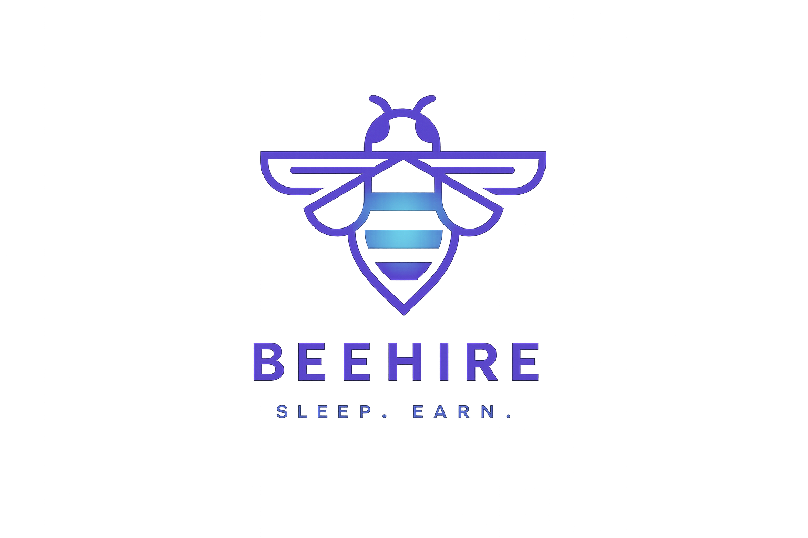

<div align="center">


# BeeHire
### Sleep. Earn.

**A speculative digital platform about labor, consent, and bodily autonomy in an AI-driven future.**

**Speculative Design** · **Product Concept** · **Interactive Web Prototype**

</div>

---

## At a Glance

| | |
|---|---|
| **Project type** | University course project · Collaborative speculative design |
| **Setting** | A fictional company operating in 2037 |
| **My role** | Original concept creator · Frontend developer · UI/UX co-designer |
| **Stack** | Next.js · React · TypeScript · Tailwind CSS · Framer Motion |
| **Outcome** | [Live interactive prototype](https://bee-hire-design.vercel.app/) and fictional company presentation |

> **What if technology let people earn money while they sleep—and what would they give up in return?**

## The Idea

BeeHire imagines a future in which AI has transformed the labor market, while some repetitive physical work still relies on human bodies. Inspired by research into **electrical muscle stimulation (EMS)**, we imagined **NeuroStitch**: a fictional wearable device that could enable selected bodily movements during sleep.

Users of the fictional BeeHire platform could sign up, select tasks, and receive simulated earnings. At first glance, the proposition looks like effortless passive income. Underneath its polished startup identity, however, the concept asks whether convenience and financial incentives can normalize the loss of control over one's own body.

**BeeHire is a critical design exploration, not a real startup, functioning EMS device, or commercially validated product.**

**[▶ Explore the live prototype](https://bee-hire-design.vercel.app/)**

## My Contributions

BeeHire was developed as a **team course project**. My contributions were:

- **Original concept:** I proposed the central idea of monetizing sleep through hypothetical future technology.
- **Product and interface design:** I co-designed the UI/UX and Figma prototypes with teammates.
- **Frontend implementation:** I independently developed the web prototype using Next.js, React, and TypeScript, translating the collaborative designs into navigable pages and interactive flows.

The broader visual identity, presentation, and project development were collaborative efforts.

## Product Experience

The prototype uses familiar digital-platform mechanics to make its fictional business feel plausible.

| Experience | Role in the concept |
|---|---|
| **Onboarding** | Introduces the promise of sleep-based earnings |
| **Contract and consent** | Presents conditions that expose tensions around autonomy and risk |
| **Task hub** | Offers simulated categories of sleep-based labor |
| **Earnings** | Frames participation through fictional income and rewards |
| **Membership and rankings** | Explores incentives, status, and gamification |
| **BeeHive community** | Imagines social proof and community around the service |
| **Profile** | Connects the experience through account-oriented screens |

### Selected project visuals

The images below are **visual assets from the fictional brand**. Interface screenshots and a complete walkthrough can be added separately.

<p align="center">
  
  &nbsp;&nbsp;
  
</p>

## Design Approach

### 1. Build a believable future

The team's presentation was staged as a fictional company event in **2037**, complete with imagined technology, corporate messaging, earnings, community stories, and partnerships. Those claims belong to the project's fictional world—not to real-world market research or traction.

### 2. Make the product attractive

The service presents sleeping hours as untapped economic value. Earnings dashboards, membership features, rankings, and community interactions borrow from familiar platform-design conventions.

### 3. Expose the contradiction

The user agreement introduces a deliberately uncomfortable trade-off: economic opportunity in exchange for physical control and uncertain risks. The contrast between friendly branding and restrictive terms is part of the critique.

## Technical Implementation

The repository contains the Next.js web prototype.

- **Framework:** Next.js (App Router)
- **Interface:** React and TypeScript
- **Styling:** Tailwind CSS
- **Motion:** Framer Motion
- **Icons:** Lucide React
- **Prototype design:** Figma (collaborative)

The current implementation focuses on front-end navigation, interface interaction, and simulated user experiences. It does **not** process real payments, control hardware, or run an AI task-allocation service.

### Try the Live Prototype

**[🌐 Open BeeHire — Live Demo](https://bee-hire-design.vercel.app/)**

The interactive web prototype is deployed on Vercel. You can explore it directly in your browser without installing anything.

<details>
<summary><strong>Run locally (for developers)</strong></summary>

Requires Node.js and npm.

```bash
git clone https://github.com/sylviaaaai/BeeHire-Design.git
cd BeeHire-Design
npm install
npm run dev
```

Open [http://localhost:3000](http://localhost:3000).

</details>

## Reflection

BeeHire explores a tension at the heart of technology-led innovation: a product can appear to improve people's lives while shifting costs and risks onto the people who use it.

The project helped me think about product design not only as interface construction but also as a way to question the values embedded in business models, incentives, and consent mechanisms.

> **Does earning without conscious effort free people from labor—or extend labor into the last hours they once controlled?**

## Scope and Transparency

- **Speculative scenario:** The 2037 setting and NeuroStitch's capabilities are hypothetical.
- **Fictional content:** Metrics, revenues, testimonials, and corporate partnerships in the presentation are narrative devices.
- **No validation claims:** We did not conduct formal user research, usability tests, or commercial feasibility validation.
- **No physical device:** The EMS wearable was conceptual; the implemented deliverable is the interactive web prototype.

---

<div align="center">
<sub>A collaborative speculative-design course project. Original concept and web implementation by Yijun Liu; UI/UX co-designed with teammates.</sub>
</div>
